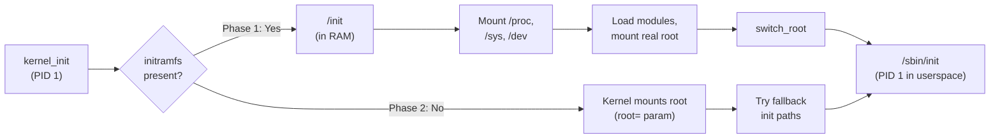

# The Linux Init Process

The [Kernel Boot Process](https://github.com/ManiAm/linux-kernel/blob/master/docs/13_kernel_boot.md) chapter covers how the Linux kernel initializes — from decompression through `start_kernel()` to the `kernel_init` thread (PID 1). Once `kernel_init` completes the kernel's internal setup, it replaces itself with a userspace program via `execve()`. That program is the **init process**, and that handoff is where this project begins.

## How the Kernel Launches Init

The kernel's `kernel_init` function in [`init/main.c`](https://github.com/torvalds/linux/blob/v6.12/init/main.c) is responsible for finding and executing the init program. This happens in two phases.

### Phase 1: Initramfs Init

On most modern distributions, an **initramfs** (initial RAM filesystem) is loaded into memory alongside the kernel during boot.

The initramfs is a small, self-contained root filesystem that lives entirely in RAM. It contains just enough tools and drivers to locate and mount the real root filesystem on disk. Its layout follows a common structure across major distributions:

    /                        ← initramfs root, mounted in RAM
    ├── init                 ← entry point — the kernel runs this as PID 1
    ├── bin/                 ← essential tools (busybox or individual binaries)
    ├── dev/                 ← populated by devtmpfs at boot
    ├── etc/                 ← minimal config (crypttab, modprobe.conf)
    ├── lib/
    │   └── modules/         ← kernel modules needed to access the root device
    │       └── 6.x.x/       (e.g., dm-mod.ko for LVM, ext4.ko, nvme.ko)
    ├── proc/                ← mount point for procfs
    ├── run/                 ← mount point for tmpfs
    ├── sbin/                ← switch_root, modprobe
    ├── sys/                 ← mount point for sysfs
    └── sysroot/             ← mount point for the real root partition

When an initramfs is present, the kernel executes `/init` inside it. This path is stored in the variable `ramdisk_execute_command`, which defaults to `"/init"` and can be overridden with the `rdinit=` kernel boot parameter.

The `/init` script begins by mounting virtual filesystems (`/proc`, `/sys`, `/dev`) — special kernel-backed filesystems that expose system information and device access rather than storing files on disk. It then performs the remaining steps to prepare the real root device:

1. Loads kernel modules required by the root device (e.g., storage drivers, filesystem drivers, LVM, RAID, or disk encryption)
2. Probes and assembles the root device (e.g., activates LVM volume groups or assembles RAID arrays)
3. Mounts the real root filesystem onto `/sysroot`
4. Calls `switch_root` to pivot from the initramfs to the real root

Up until step 3, the initramfs is running entirely in RAM — no disk partition has been mounted yet. Once `switch_root` completes, it executes the **real init program** on the mounted root filesystem, replacing the initramfs `/init` process. PID 1 is preserved throughout — only the binary it runs changes.

The [Filesystem Hierarchy Standard (FHS)](https://refspecs.linuxfoundation.org/FHS_3.0/fhs/ch03s16.html) specifies `/sbin/init` as the standard location for the init binary. The initramfs `/init` script hardcodes this path in the `switch_root` call:

    exec switch_root /sysroot /sbin/init

This tells `switch_root` to pivot the root to `/sysroot` and then execute `/sbin/init` on the new root filesystem.

> For a detailed walkthrough of how the initramfs mounts the real root partition and hands off via `switch_root`, see [Mounting](https://github.com/ManiAm/storage-and-file-systems/blob/master/docs/15_mounting.md).

### Phase 2: Direct Init Execution

If no initramfs is present, or if the initramfs `/init` is not found, the kernel skips the ramdisk phase and mounts the root filesystem directly (using the `root=` boot parameter). It then searches for an init program by trying these paths in order:

1. The path specified by the `init=` kernel command-line parameter
2. The compile-time `CONFIG_DEFAULT_INIT` path (if configured)
3. `/sbin/init`
4. `/etc/init`
5. `/bin/init`
6. `/bin/sh` (as a last resort)

If none of these yield a valid executable, the kernel panics:

    No working init found.  Try passing init= option to kernel.
    See Linux Documentation/admin-guide/init.rst for guidance.

Phase 2 serves as a fallback for systems that boot without an initramfs, such as minimal embedded setups or VMs with all necessary drivers built directly into the kernel. On typical desktop and server distributions, Phase 1 handles everything.

### What `/sbin/init` Points To

On most Linux distributions, `/sbin/init` is a symbolic link to the actual init system binary. For example, on systems running systemd:

    $ ls -l /sbin/init
    lrwxrwxrwx 1 root root 22 Dec  1 12:00 /sbin/init -> /lib/systemd/systemd

The `init=` boot parameter allows overriding this default. This is useful for debugging or recovery — for example, booting directly into a shell:

    init=/bin/bash

The last `dmesg` line before the transition to userspace confirms which binary the kernel selected:

    [    1.500000] Run /sbin/init as init process

## PID 1

Regardless of which path the kernel takes, the result is the same: PID 1 is now running a userspace binary — the init process. It is the first userspace process and the ancestor of every other process on the system.

    $ ps -p 1
      PID TTY          TIME CMD
        1 ?        00:00:01 systemd

The **TTY** column shows the controlling terminal associated with a process. A **TTY** (short for **teletypewriter**) is the terminal device through which a process receives input and sends output — for example, `/dev/tty1` for a virtual console or `pts/0` for a terminal emulator. The `?` shown for PID 1 means the process has no controlling terminal. This is expected — init is started by the kernel before any terminal exists, and it runs as a background system process for the lifetime of the machine.

Every other process is either started directly by init or by one of its descendants, forming a process tree rooted at PID 1:

    $ pstree -p

    systemd(1)─┬─cron(459)
               ├─dbus-daemon(431)
               ├─sshd(498)───sshd(700)───bash(701)───pstree(729)
               ├─udevd(180)
               └─rsyslogd(490)

PID 1 receives special treatment from the kernel. It cannot be killed by signals that would terminate any other process — the kernel ignores signals sent to PID 1 unless the process has explicitly installed a handler for that signal. If PID 1 exits for any reason, the kernel panics and the system halts. This makes init the one process that must always be running.

## Responsibilities

Once running, the init process takes ownership of the entire system lifecycle — from initial setup through normal operation to shutdown. The specific mechanisms differ between init systems (covered in the [next chapter](02_init_systems.md)), but the core responsibilities are the same.

### 1. System Initialization

Init reads its configuration and performs early system setup:

- Mounts additional filesystems listed in `/etc/fstab`
- Sets the system hostname
- Configures network interfaces
- Activates swap space
- Sets the system clock

### 2. Starting and Managing Services

Init starts the system **services** — long-running background programs (also called **daemons**) that provide core system functionality. Examples include logging (`rsyslog`, `journald`), cron scheduling, and remote access (`sshd`).

The mechanism for starting services varies by init system. SysV init executes shell scripts sequentially based on [runlevels](03_sysv_init.md), while [systemd](04_systemd.md) starts services in parallel based on dependency graphs defined in unit files.

### 3. Managing System State

Init defines and manages the overall operating state of the system. Traditional init systems use **runlevels** (numbered 0–6) to represent states like single-user mode, multi-user mode, or graphical mode. Modern init systems like systemd use **targets** to represent these same states with greater flexibility.

For example, transitioning the system from a text console to a graphical desktop means changing from one state to another — a process coordinated entirely by init.

### 4. Adopting Orphan Processes

When a parent process terminates before its children, those children become **orphan processes**. The kernel automatically reassigns orphaned processes to PID 1, making init their new parent. This ensures every process in the system always has a parent and can be properly waited on and cleaned up.

### 5. Reaping Zombie Processes

When a process exits, it does not fully disappear. It remains in the process table as a **zombie** — a terminated process whose exit status has not yet been collected by its parent. Collecting this status is called **reaping**, and it is done via the `wait()` system call. If the original parent is gone, init — as the adopted parent — is responsible for reaping these zombies to free their process table entries.

Without a functioning init to reap zombies, they would accumulate and eventually exhaust the system's process table, preventing new processes from being created.

### 6. Signal Handling

Init handles critical system signals:

- **SIGTERM / SIGINT** — initiate a graceful system shutdown
- **SIGHUP** — reload configuration (in some init systems)

When a user runs `shutdown` or `reboot`, these commands send signals to PID 1, which then coordinates the orderly stopping of all services and the final system halt or restart.

## Login Prompt

Once init has started all configured services, the system is ready for user interaction. Init starts one of the following to provide a login interface:

- **`getty`** — for text-based terminal logins. It displays a login prompt, authenticates the user against `/etc/passwd` and `/etc/shadow`, and starts a shell (e.g., `bash`) on successful login.

- **Display Manager** (e.g., GDM, LightDM, SDDM) — for graphical logins. The display manager presents a graphical login screen and, after authentication, loads the desktop environment (e.g., GNOME, KDE).

---

[Next: Init Systems →](02_init_systems.md)
