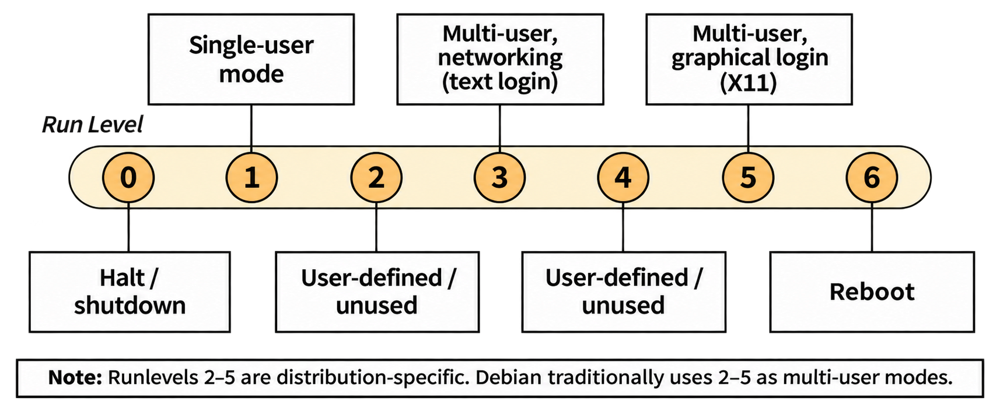

# SysV Init

The [previous chapter](02_init_systems.md) introduced SysV init as one of the earliest init systems, originating in UNIX System V in 1983. This chapter covers how it works in detail — runlevels, init scripts, directory layout, and the boot flow.

## Runlevels

SysV init organizes the system into **runlevels** — numbered states (0–6) that define which services are running. Each runlevel represents a different mode of operation:

| Runlevel | Description                              |
|----------|------------------------------------------|
| 0        | Halt (shut down the system)              |
| 1        | Single-user mode (rescue / maintenance)  |
| 2        | Multi-user mode without networking       |
| 3        | Full multi-user mode with networking     |
| 4        | Unused (available for custom use)        |
| 5        | Multi-user mode with graphical interface |
| 6        | Reboot                                   |



Runlevels 0 and 6 are transitional — entering runlevel 0 halts the system, and entering runlevel 6 reboots it. The intermediate runlevels (1–5) define different operational states, determining which services are started, which filesystems are mounted, and whether networking or a graphical interface is available. The exact configuration of each runlevel can vary between distributions and can be customized by administrators.

Lower runlevels are useful for maintenance. Runlevel 1 (single-user mode) provides a minimal environment without networking — typically used for emergency repairs or filesystem checks.

To check the current and previous runlevel:

    $ runlevel
    N 5

The output shows two values: the **previous runlevel** and the **current runlevel**. `N` means there was no previous runlevel — the system booted directly into runlevel 5.

## Directory Structure

### `/etc/init.d/` — Service Scripts

`/etc/init.d/` is the central location for all service scripts. Each script manages a single service (e.g., `apache2`, `sshd`, `networking`) and accepts commands like `start`, `stop`, `restart`, and `status`.

    $ ls /etc/init.d/
    acpid  anacron  apport  cron  dbus  networking  rsyslog  ssh  udev

### `/etc/rc[0-6].d/` — Runlevel Directories

For each runlevel, a corresponding directory (`/etc/rc0.d/` through `/etc/rc6.d/`) contains symbolic links to scripts in `/etc/init.d/`. These links control which services are started or stopped when the system enters that runlevel:

    $ ls -l /etc/rc2.d/
    lrwxrwxrwx 1 root root 16 Dec  1 12:13 K01apport -> ../init.d/apport
    lrwxrwxrwx 1 root root 27 Dec  1 12:13 K01speech-dispatcher -> ../init.d/speech-dispatcher
    lrwxrwxrwx 1 root root 15 Dec  1 12:13 S01acpid -> ../init.d/acpid
    lrwxrwxrwx 1 root root 17 Dec  1 12:13 S01anacron -> ../init.d/anacron

The link names follow a specific naming convention (explained in [Script Naming and Execution Order](#script-naming-and-execution-order) below).

The term `rc` comes from **"runcom"** (run commands) — a concept dating back to the CTSS (Compatible Time-Sharing System) in the 1960s, where "runcom" files executed sequences of commands automatically.

### `/etc/rcS.d/` — System Initialization Scripts

The `/etc/rcS.d/` directory contains scripts that run once during early system startup, **before** any runlevel is entered. These handle critical initialization tasks such as mounting filesystems, setting the hostname, and loading kernel modules. The `S` in `rcS.d` stands for "startup".

## Script Naming and Execution Order

Each symbolic link in the `rc` directories follows this naming format:

    S<NN><name>
    K<NN><name>

- **`S`** (Start) — the service is started when entering this runlevel
- **`K`** (Kill) — the service is stopped when entering this runlevel
- **`NN`** — a two-digit number that determines execution order (lower numbers run first)

When the system enters a runlevel, init processes the corresponding `/etc/rcX.d/` directory:

1. All **K** scripts run first (in ascending order: K01, K02, ..., K99) to stop services that should not be running in the new runlevel
2. All **S** scripts run next (in ascending order: S01, S02, ..., S99) to start services for the new runlevel

Scripts with the same number are executed in alphabetical order (e.g., `S10cron` runs before `S10dbus`).

By convention, K script numbers are set so that services are stopped in the reverse order they were started. For example, if a service starts as `S20apache2`, its corresponding stop link would be `K80apache2` — ensuring it is stopped before services that started earlier.

## Init Scripts

SysV init scripts are shell scripts that follow a standard format defined by the **LSB** (Linux Standard Base). Each script contains an LSB header block with metadata about the service, followed by a `case` statement that handles the supported commands:

```bash
#!/bin/bash

### BEGIN INIT INFO
# Provides:          my-service
# Required-Start:    $remote_fs $syslog
# Required-Stop:     $remote_fs $syslog
# Default-Start:     2 3 4 5
# Default-Stop:      0 1 6
# Short-Description: Start my-service at boot time
# Description:       Longer description of the service
### END INIT INFO

. /lib/lsb/init-functions

case "$1" in
  start)
    echo "Starting my-service..."
    # Commands to start the service
    ;;
  stop)
    echo "Stopping my-service..."
    # Commands to stop the service
    ;;
  restart)
    $0 stop
    $0 start
    ;;
  status)
    echo "Checking status of my-service..."
    # Commands to check the service status
    ;;
  *)
    echo "Usage: $0 {start|stop|restart|status}"
    exit 1
esac

exit 0
```

The **LSB header** (`### BEGIN INIT INFO` ... `### END INIT INFO`) provides metadata that the init system uses to manage dependencies and determine which runlevels the service should be active in:

| Header              | Purpose                                                  |
|---------------------|----------------------------------------------------------|
| `Provides`          | The service name this script manages                     |
| `Required-Start`    | Services that must be running before this one can start  |
| `Required-Stop`     | Services that must still be running when this one stops  |
| `Default-Start`     | Runlevels in which this service should be started        |
| `Default-Stop`      | Runlevels in which this service should be stopped        |
| `Short-Description` | One-line summary of the service                          |

The `. /lib/lsb/init-functions` line sources a library of helper functions (`log_success_msg`, `log_failure_msg`, `status_of_proc`) that simplify script output.

Init passes commands like `start`, `stop`, `restart`, and `status` as the first argument (`$1`) to the script. For example, when entering runlevel 3, init runs:

    /etc/rc3.d/S20my-service start

When leaving runlevel 3:

    /etc/rc3.d/K80my-service stop

| Command   | Description                                                          |
|-----------|----------------------------------------------------------------------|
| `start`   | Start the service                                                    |
| `stop`    | Stop the service gracefully                                          |
| `restart` | Stop and then start the service (applies configuration changes)      |
| `status`  | Report whether the service is running, stopped, or in an error state |

## Managing Scripts

To add a new service script, copy it to `/etc/init.d/` and make it executable:

    $ sudo chmod +x /etc/init.d/my-service

Then use `update-rc.d` to create the symbolic links in the `/etc/rc[0-6].d/` directories based on the script's `Default-Start` and `Default-Stop` headers:

    $ sudo update-rc.d my-service defaults

To remove a service, stop it first and then remove its symbolic links:

    $ sudo /etc/init.d/my-service stop
    $ sudo update-rc.d -f my-service remove

This deletes the symbolic links in `/etc/rc[0-6].d/`. The script itself can also be removed from `/etc/init.d/` if it is no longer needed.

## Boot Flow

The following sequence describes how SysV init boots the system. For details on how the kernel starts init, see [The Init Process](01_init.md).

1. **The kernel starts `/sbin/init`** — which on a SysV system is the SysV init binary (PID 1).

2. **init reads `/etc/inittab`** — this file defines the default runlevel and the actions to perform at each runlevel. For example:

        id:5:initdefault:

    This line sets the default runlevel to 5 (multi-user with graphical interface). Init jumps directly to the configured default — it does not start at runlevel 0 and progress upward through each level. With a default of 5, the boot path is:

        /etc/rcS.d/  →  /etc/rc5.d/  →  done (system is in runlevel 5)

3. **init runs `/etc/rcS.d/` scripts** — one-time system initialization tasks (mounting filesystems, setting the clock, loading modules). These run **before** the default runlevel is entered.

4. **init runs `/etc/rc5.d/` scripts** — K scripts stop unneeded services, then S scripts start the services for runlevel 5, in numerical order. (If the default were 3, init would run `/etc/rc3.d/` instead.)

5. **init spawns `getty` on configured terminals** — providing login prompts for users. The terminals are also defined in `/etc/inittab`:

        1:2345:respawn:/sbin/getty 38400 tty1

    This tells init to spawn `getty` on `tty1` for runlevels 2–5, and respawn it automatically if it exits.

At this point the system is fully booted and running in the default runlevel. It stays in this runlevel until an administrator explicitly changes it.

## Changing Runlevels

An administrator can switch to a different runlevel at any time using the `init` or `telinit` command:

    $ sudo init 3        # switch to runlevel 3 (text multi-user)
    $ sudo telinit 1     # switch to runlevel 1 (single-user / rescue)
    $ sudo init 0        # halt the system (runlevel 0)
    $ sudo init 6        # reboot the system (runlevel 6)

These commands tell the running init process (PID 1) to transition to the specified runlevel. During the transition, init processes the target runlevel's `/etc/rcX.d/` directory — running K scripts to stop services that should not be in the new runlevel, then S scripts to start any new services.

For example, switching from **runlevel 5** (graphical) to **runlevel 3** (text multi-user):

    /etc/rc5.d/S20gdm   → ../init.d/gdm    (display manager runs in runlevel 5)
    /etc/rc3.d/K80gdm   → ../init.d/gdm    (display manager not needed in runlevel 3)

The same script (`/etc/init.d/gdm`) appears as an **S** link in runlevel 5 and a **K** link in runlevel 3. When init transitions to runlevel 3, it runs `K80gdm stop`, which shuts down the graphical login manager. The **scripts are always the same** — what differs per runlevel is which symbolic links exist and whether they are prefixed with `S` or `K`.

After the switch, the `runlevel` command reflects the change:

    $ runlevel
    5 3

The previous runlevel is now `5` and the current runlevel is `3`.

## Limitations

SysV init served the UNIX and Linux world for decades, but its design has several limitations that led to its replacement by modern init systems:

1. **Sequential startup** — Services start one after another, even when they have no dependencies between them. This results in slow boot times on modern hardware with multi-core processors.

2. **Limited dependency management** — There is no native mechanism to express dependencies between services. Administrators must manually order scripts by choosing the right `NN` numbers, which is error-prone and difficult to maintain.

3. **No service monitoring** — If a service crashes after startup, SysV init does not detect or restart it. Administrators must use external tools or manually intervene.

4. **Minimal logging** — SysV init provides little built-in logging for service startup and failures. Debugging typically requires manually inspecting init scripts or system log files.

5. **No event handling** — SysV init does not react to runtime events like hardware changes, network state transitions, or process failures. It relies entirely on static runlevel configurations.

6. **Rigid runlevel model** — The fixed set of seven runlevels (0–6) cannot easily accommodate complex or overlapping system states that modern systems require.

---

[← Previous: Init Systems](02_init_systems.md) | [Next: Systemd Overview →](04_systemd.md)
