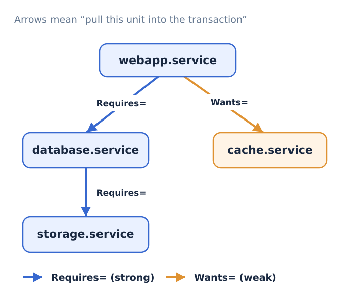
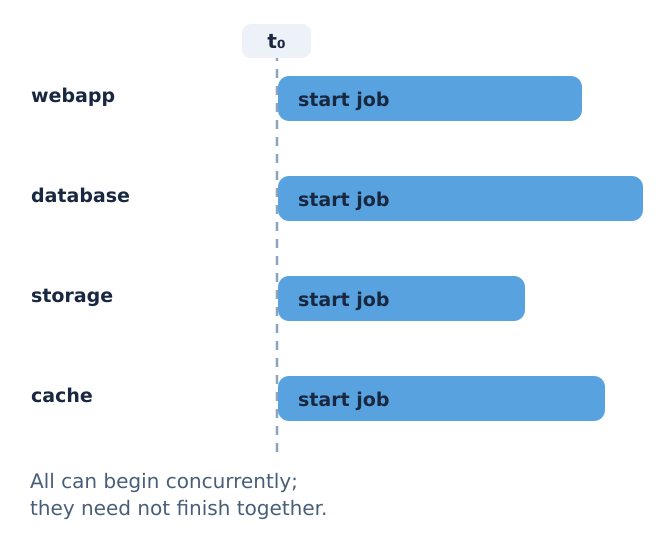
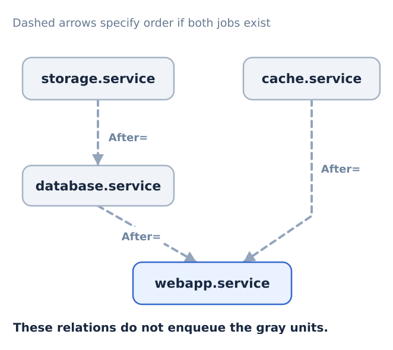
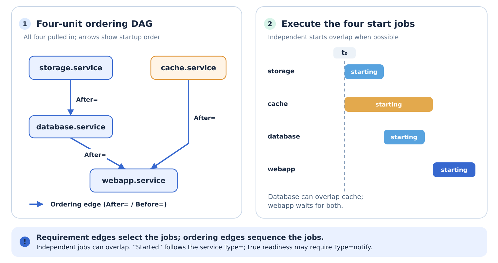

# Unit Dependencies

systemd uses two kinds of dependencies to manage relationships between units: **requirement dependencies** and **ordering dependencies**. These two kinds are independent — setting one does not imply the other. Understanding this distinction is the single most important concept in this chapter.

## Requirement Dependencies

Requirement dependencies control whether other units are *pulled in* (started) when this unit starts. They answer the question: "Which other units should be started alongside this unit, and what happens if they fail?"

These directives are placed in the `[Unit]` section:

| Directive    | Starts the listed units? | If they fail to start                         | If they stop later                                   |
|--------------|--------------------------|-----------------------------------------------|------------------------------------------------------|
| `Wants=`     | Yes                      | This unit starts anyway                       | No effect                                            |
| `Requires=`  | Yes                      | This unit fails too (if `After=` is also set) | This unit is stopped too (explicit stops only)       |
| `Requisite=` | No (must already be running) | This unit fails immediately                | No effect                                            |
| `BindsTo=`   | Yes                      | This unit fails too (if `After=` is also set) | This unit is stopped too (any stop, including self-deactivation) |
| `Upholds=`   | Yes (continuously)       | This unit starts anyway                       | Listed units are restarted                           |

Additional details that are important but do not fit in the table:

- **`Wants=`** is the recommended default. Because it never causes this unit to fail or stop, it produces the most resilient configurations.

- **`Requires=`** adds failure coupling. Two nuances: (1) startup failure only blocks this unit when `After=` is also set — without ordering, both units start in parallel and the failure may arrive too late to propagate; (2) only *explicit* stops (e.g., `systemctl stop`) propagate — if the required unit's process exits on its own (self-deactivation), this unit is **not** stopped.

- **`Requisite=`** is a pre-check. Unlike `Requires=`, systemd will not attempt to start the listed units — they must already be active, or this unit fails immediately.

- **`BindsTo=`** is the strictest form. It has all the effects of `Requires=`, plus: if the bound unit stops for **any** reason — including self-deactivation — this unit is stopped too. Use `BindsTo=` together with `After=` to guarantee this unit is never active without the other.

- **`Upholds=`** is a persistent form of `Wants=`. As long as this unit is active, systemd continuously ensures the listed units are running, restarting them if they stop or fail.

**Key point:** requirement dependencies do **not** imply ordering. All pulled-in units could start simultaneously. To control the sequence, add ordering dependencies.

## Ordering Dependencies

Ordering dependencies control the *sequence* in which units start and stop. They answer the question: "If two units are both being started, which one goes first?"

These directives are also placed in the `[Unit]` section:

| Directive  | Description                                                              |
|------------|--------------------------------------------------------------------------|
| `Before=`  | Delay the listed units' startup until this unit has finished starting    |
| `After=`   | Delay this unit's startup until the listed units have finished starting  |

For example, if `sshd.service` has `After=network.target`, then systemd waits for `network.target` to finish starting before it starts `sshd.service`.

**Key points:**

- Ordering dependencies do **not** cause units to be started. `After=B` only has an effect if B is also being started (by a requirement dependency or an explicit command).
- During shutdown, the order is reversed: if A starts after B, then A stops before B.

## Dependency Graph

When you run `systemctl start webapp.service`, systemd does not simply start that one unit. It builds a **transaction** — the full set of units that need to start — by walking requirement dependencies. It then uses ordering dependencies to sequence the transaction into a directed acyclic graph (DAG). If the ordering contains a cycle, systemd attempts to break it by dropping non-essential jobs.

The process has two phases:

1. **Collect units** — requirement dependencies (`Wants=`, `Requires=`, etc.) determine *which* units enter the transaction
2. **Order execution** — ordering dependencies (`After=`, `Before=`) determine *when* each unit starts relative to the others

The following three steps illustrate each type of dependency in isolation, then show the result of combining them.

### Step 1: Requirement dependencies only

Consider four units with only requirement dependencies:

```ini
# webapp.service
[Unit]
Requires=database.service
Wants=cache.service
```

```ini
# database.service
[Unit]
Requires=storage.service
```

```ini
# storage.service — no dependencies
```

```ini
# cache.service — no dependencies
```

You can ask systemd to show the requirement tree for any unit:

    $ systemctl list-dependencies --all webapp.service

```
webapp.service
├── database.service      (Requires)
│   └── storage.service   (Requires)
└── cache.service         (Wants)
```

The `--all` flag recursively expands every dependency. The actual output also includes implicit dependencies that systemd adds automatically (such as `basic.target` and `app.slice`) — only the explicit dependencies are shown above.



This tree shows which units systemd will pull into the transaction. When you run `systemctl start webapp.service`, systemd walks this requirement graph, collects all four units, and starts them. But there are no ordering dependencies, so all four units start **simultaneously**:



**Limitation:** `webapp.service` could attempt to connect to the database before `database.service` is ready. Requirement dependencies determine *what* to start, but not *when*.

### Step 2: Ordering dependencies only

Now suppose the same four units have only ordering dependencies (no requirement dependencies):

```ini
# webapp.service
[Unit]
After=database.service cache.service
```

```ini
# database.service
[Unit]
After=storage.service
```

```ini
# storage.service — no dependencies
```

```ini
# cache.service — no dependencies
```

The requirement tree is empty — no units are pulled in:

    $ systemctl list-dependencies --all webapp.service

```
webapp.service
  (no requirement dependencies)
```

But the ordering tree shows the `After=` relationships:

    $ systemctl list-dependencies --after --all webapp.service

```
webapp.service
├── cache.service
├── database.service
│   └── storage.service
```



The ordering edges exist, but they have nothing to act on. Running `systemctl start webapp.service` starts only `webapp.service` — the other three units are not in the transaction because nothing pulled them in. The `After=` directives have no effect because they only apply to units that are already being started.

**Limitation:** ordering dependencies determine *when* to start, but they do not cause units to be started.

### Step 3: Combining both

When you combine requirement and ordering dependencies, systemd can build a complete DAG:

```ini
# webapp.service
[Unit]
Requires=database.service
Wants=cache.service
After=database.service cache.service
```

```ini
# database.service
[Unit]
Requires=storage.service
After=storage.service
```

```ini
# storage.service — no dependencies
```

```ini
# cache.service — no dependencies
```

Now both commands show the full picture:

    $ systemctl list-dependencies --all webapp.service

```
webapp.service
├── cache.service
├── database.service
│   └── storage.service
```

    $ systemctl list-dependencies --after --all webapp.service

```
webapp.service
├── cache.service
├── database.service
│   └── storage.service
```

Requirement dependencies collect the transaction (four units). Ordering dependencies sequence them into a DAG:



An arrow means "must finish starting before." Reading the graph:

| Phase | What starts                              | Why                                                             |
|-------|------------------------------------------|-----------------------------------------------------------------|
| 1     | `storage.service` and `cache.service`    | No `After=` constraints on them — they start in parallel        |
| 2     | `database.service`                       | Starts after `storage.service` finishes                         |
| 3     | `webapp.service`                         | Starts after both `database.service` and `cache.service` finish |

Units in the same phase run in parallel. Units in different phases run in sequence. This is how systemd maximizes parallelism while respecting ordering constraints.

### Summary

| Dependency type | Role                         | Alone, it cannot                                                       |
|-----------------|------------------------------|------------------------------------------------------------------------|
| Requirement     | Determines **what** to start | Control the sequence — all units start simultaneously                  |
| Ordering        | Determines **when** to start | Cause units to be started — they must already be in the transaction    |

In practice, you almost always need both. The common pattern is to pair `Requires=` (or `Wants=`) with `After=` on the same units.

## Conflicts

| Directive    | Description                                                                                             |
|--------------|---------------------------------------------------------------------------------------------------------|
| `Conflicts=` | The listed units cannot be active at the same time as this unit — starting this unit stops them, and vice versa |

## Triggered Actions

| Directive    | Description                                                                             |
|--------------|-----------------------------------------------------------------------------------------|
| `OnSuccess=` | Activate the listed units when this unit deactivates successfully (enters `inactive`)   |
| `OnFailure=` | Activate the listed units when this unit enters the `failed` state                      |

Note: a service with `Restart=` only enters the `failed` state after its restart limit is reached.

## Composition

| Directive           | Description                                                                          |
|---------------------|--------------------------------------------------------------------------------------|
| `PartOf=`           | If the listed units are stopped or restarted, this unit is stopped or restarted too  |
| `JoinsNamespaceOf=` | Share the network and/or temporary file namespace of the listed units                |
| `Slice=`            | Place this unit in the specified slice for cgroup resource management (default: `system.slice`) |

## Propagation

| Directive               | Description                                               |
|-------------------------|-----------------------------------------------------------|
| `PropagatesReloadTo=`   | When this unit is reloaded, also reload the listed units  |
| `ReloadPropagatedFrom=` | When the listed units are reloaded, also reload this unit |
| `PropagatesStopTo=`     | When this unit is stopped, also stop the listed units     |
| `StopPropagatedFrom=`   | When the listed units are stopped, also stop this unit    |

## Install Section Dependencies

The following directives belong in the `[Install]` section (not `[Unit]`) and take effect when `systemctl enable` is run. See [Unit Files — Install Section](06_systemd_unit_files.md#install-section) for details.

| Directive      | Description                                                          |
|----------------|----------------------------------------------------------------------|
| `WantedBy=`    | Create a `Wants=` dependency from the listed targets to this unit    |
| `RequiredBy=`  | Create a `Requires=` dependency from the listed targets to this unit |

## Automatic Reverse Properties

Many of the directives above have **automatic reverse counterparts** that appear as read-only properties in `systemctl show` output. These cannot be written in unit files — systemd generates them automatically:

| When you write | systemd shows this on the target unit |
|----------------|---------------------------------------|
| `Requires=B`   | `RequiredBy=A` on unit B              |
| `Requisite=B`  | `RequisiteOf=A` on unit B             |
| `Wants=B`      | `WantedBy=A` on unit B                |
| `BindsTo=B`    | `BoundBy=A` on unit B                 |
| `Upholds=B`    | `UpheldBy=A` on unit B                |
| `Conflicts=B`  | `ConflictedBy=A` on unit B            |
| `PartOf=B`     | `ConsistsOf=A` on unit B              |

systemd also generates `Triggers=` and `TriggeredBy=` automatically between socket, path, and timer units and the units they activate.

Note: the `WantedBy=` and `RequiredBy=` names appear in two different contexts. In the `[Install]` section, they are writable directives that create symlinks when you run `systemctl enable`. In `systemctl show` output, they are read-only reverse properties that systemd computes at runtime.

## Viewing Dependencies

By default, `systemctl list-dependencies` shows the **requirement** dependency tree — specifically `Wants=`, `Requires=`, `Requisite=`, `BindsTo=`, and `ConsistsOf=` relationships. It does not show ordering dependencies unless you pass `--after` or `--before`:

    $ systemctl list-dependencies <unit>

Useful flags:

| Flag        | Description                                                                          |
|-------------|--------------------------------------------------------------------------------------|
| `--all`     | Recursively expand every dependency (without it, only target units are expanded)     |
| `--after`   | Show ordering dependencies — which units this unit starts after                      |
| `--before`  | Show ordering dependencies — which units this unit starts before                     |
| `--reverse` | Show reverse dependencies — which units depend on this unit                          |

To visualize the dependency graph as a DOT diagram (useful for complex dependency chains):

    $ systemd-analyze dot <unit> | dot -Tsvg -o deps.svg

---

[← Previous: Service Configuration](07_systemd_services.md) | [Next: Syslog →](09_syslog.md)
