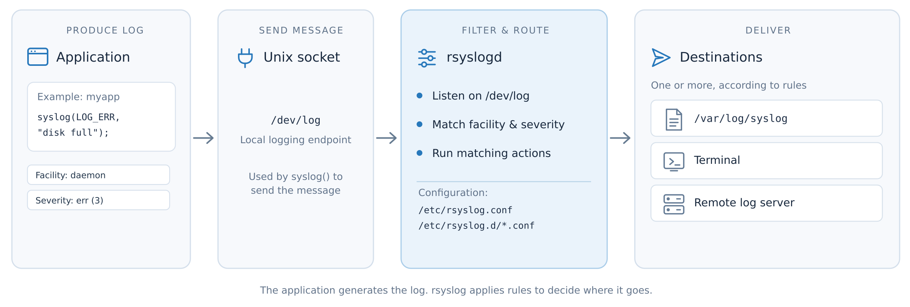

# Syslog

Every running program on a Linux system may need to report errors, warnings, or status information. **Logging** is how that information is captured and stored so administrators can diagnose problems, audit activity, and monitor system health.

Linux provides two logging systems: the traditional **syslog** framework (covered in this chapter) and systemd's **journald** (covered in the [next chapter](10_systemd_journald.md)). Syslog came first and remains widely used; understanding it is essential before learning how `journald` builds on top of it.

## How Syslog Works

Programs send log messages by calling the C `syslog()` function (or by writing to the `/dev/log` Unix socket). Each message carries two pieces of metadata:

- **Facility** — which subsystem produced it (e.g., `kern`, `daemon`, `auth`, `local0`)
- **Severity** — how important it is (see the log levels table below)

A **syslog daemon** listens on `/dev/log`, receives every message, and routes it to a destination — typically a plain text file such as `/var/log/syslog`. Programs only emit messages; the daemon decides where they go.

## Log Levels

The eight severity levels are defined by the syslog standard (RFC 5424). Level 0 is the most severe, level 7 is the least. These same levels are shared by `journald`.

| Level     | Code | Description                                  |
|-----------|------|----------------------------------------------|
| `emerg`   | 0    | System is unusable                           |
| `alert`   | 1    | Immediate action required                    |
| `crit`    | 2    | Critical condition                           |
| `err`     | 3    | Error condition                              |
| `warning` | 4    | Warning condition                            |
| `notice`  | 5    | Normal but significant event                 |
| `info`    | 6    | Informational message                        |
| `debug`   | 7    | Debugging message (typically for developers) |

## Example

Here is a minimal C program that sends one message at each of three severity levels:

```c
#include <syslog.h>

int main(void)
{
    openlog("myapp", LOG_PID, LOG_DAEMON);     // identity="myapp", facility=daemon

    syslog(LOG_ERR,    "disk full on /var");   // severity 3
    syslog(LOG_NOTICE, "service started");     // severity 5
    syslog(LOG_DEBUG,  "counter = %d", 42);    // severity 7

    closelog();
    return 0;
}
```

`openlog()` sets the program name (`myapp`) and the facility (`LOG_DAEMON`). Each `syslog()` call then only needs a severity and a message — the syslog daemon handles the rest.

After compiling and running the program, the messages appear in `/var/log/syslog`:

```
Oct  7 21:37:36 myhost myapp[4070575]: disk full on /var
Oct  7 21:37:36 myhost myapp[4070575]: service started
Oct  7 21:37:36 myhost myapp[4070575]: counter = 42
```

Each line follows a standard format:

```
Oct  7 21:37:36 myhost myapp[4070575]: disk full on /var
│               │      │     │         └─ message
│               │      │     └─ PID
│               │      └─ program name (from openlog)
│               └─ hostname
└─ timestamp
```

Whether the DEBUG-level line (`counter = 42`) appears depends on the syslog daemon's configured severity threshold. A threshold of `notice`, for example, means only messages at `notice` and above (codes 0–5) are kept — the `debug` line would be suppressed.

This is the core syslog model: programs emit messages with a facility and a severity, and a separate daemon decides where those messages go. Without a syslog daemon running, the messages would go nowhere.

## rsyslog

`rsyslog` is the most common syslog daemon on Debian-based systems (including Ubuntu). It is significantly more capable than the original `syslogd` — it supports structured logging, reliable transport protocols, content-based filtering, and high-throughput message processing.

`rsyslog` listens for incoming syslog messages and routes them to destinations — log files, the console, or remote servers — based on configurable rules. The diagram below shows this full path from application to destination:



Its configuration lives in two places:

- `/etc/rsyslog.conf` — the main configuration file
- `/etc/rsyslog.d/*.conf` — drop-in files for modular rules

Drop-in files are loaded in **lexicographic order**, so a numeric prefix controls priority: a file named `00-early.conf` is processed before `99-catchall.conf`. This ordering matters because `rsyslog` evaluates rules top-to-bottom — a message caught by an earlier rule can be stopped from reaching later rules.

## rsyslog Routing Rules

Each routing rule consists of a **selector** and an **action**, separated by whitespace. The selector decides which messages match; the action decides what to do with them.

### Selector Syntax

A selector has the form `facility.severity`. The severity is a **threshold** — it matches that level and everything more severe. A few examples:

```
kern.*                /var/log/kern.log
```

`kern.*` matches all kernel messages regardless of severity. The action writes them to `/var/log/kern.log`.

```
mail.crit             /var/log/mail-critical.log
```

`mail.crit` matches mail messages at `crit` severity and above (i.e., `crit`, `alert`, and `emerg`).

```
*.emerg               :omusrmsg:*
```

`*.emerg` matches emergency messages from any facility. The action `:omusrmsg:*` sends them to all logged-in users' terminals.

### Combining Selectors

Multiple facilities can share a severity using commas. Multiple selectors can be combined on one line using semicolons:

```
auth,authpriv.*       /var/log/auth.log
```

This writes all messages from both `auth` and `authpriv` facilities to a single file.

```
*.*;auth,authpriv.none    /var/log/syslog
```

This writes all messages from all facilities to `/var/log/syslog`, **except** those from `auth` and `authpriv` (which the `.none` keyword excludes). This is a common pattern — dedicated rules handle specific facilities, and a catch-all rule handles everything else.

### The `stop` Directive

By default, a message that matches one rule continues to be evaluated against subsequent rules. The `stop` directive (or its legacy equivalent `& ~`) tells `rsyslog` to discard the message after the current action, preventing it from reaching later rules:

```
local0.warning        /var/log/local0-warning.log
& stop
```

Without `& stop`, messages matching `local0.warning` would also appear in `/var/log/syslog` if a later catch-all rule sends `*.*` there.

### Property-Based Filters

Beyond the traditional selector syntax, `rsyslog` can filter on any message property. This is useful for routing by program name or message content:

```
:programname, isequal, "sshd"    /var/log/sshd.log
& stop
```

This sends all messages from the `sshd` program to a dedicated file. The `:programname, isequal, "sshd"` syntax is a property-based filter — it checks the `programname` property for an exact match.

```
:msg, contains, "error"    /var/log/errors.log
```

This catches any message whose text contains the word "error", regardless of which program or facility produced it.

## rsyslog Rate Limiting

When a misbehaving program floods the syslog socket with thousands of messages per second, it can overwhelm the daemon and fill the disk. `rsyslog` protects against this with rate limiting on its Unix socket input module (`imuxsock`):

```
module(load="imuxsock" SysSock.RateLimit.Interval="5" SysSock.RateLimit.Burst="200")
```

This configuration allows up to **200 messages** within any **5-second** window. If a program exceeds this rate, `rsyslog` drops the excess messages and logs a single warning indicating how many were suppressed. Once the interval resets, message delivery resumes normally.

The defaults vary by distribution. You can tune these values based on your system's workload — a busy server with many services may need a higher burst limit, while a quiet embedded device can use a lower one.

## Standard Log Files

The routing rules described above determine which text files `rsyslog` writes. The exact set depends on the distribution. The table below shows the files that are **active out of the box** on the two major distribution families:

| Purpose                        | Debian / Ubuntu              | Red Hat / RHEL / Fedora       |
|--------------------------------|------------------------------|-------------------------------|
| General system messages        | `/var/log/syslog`            | `/var/log/messages`           |
| Authentication (SSH, sudo)     | `/var/log/auth.log`          | `/var/log/secure`             |
| Kernel messages                | `/var/log/kern.log`          | (included in `/var/log/messages`) |
| Mail system                    | `/var/log/mail.log`          | `/var/log/maillog`            |
| Cron jobs                      | (not enabled by default)     | `/var/log/cron`               |
| Boot messages                  | (not a separate file)        | `/var/log/boot.log`           |

> **Note:** On Debian/Ubuntu, additional files like `/var/log/daemon.log` and `/var/log/cron.log` are available as routing rules in the rsyslog config but are **commented out** by default. Uncomment them in `/etc/rsyslog.d/50-default.conf` if you need them.

## Log Rotation

These text log files grow continuously. Without management, they will eventually fill the disk. **Log rotation** is the process of archiving the current log file and starting a fresh one, so that no single file grows without bound.

### How logrotate Works

`logrotate` is the standard Linux tool for rotating text log files. It is typically invoked once per day by a cron job or a systemd timer. Each time it runs, it checks each managed log file and rotates any that meet the configured criteria (age or size).

Its configuration lives in two places:

- `/etc/logrotate.conf` — global defaults
- `/etc/logrotate.d/` — per-application drop-in files

### Configuration Syntax

A `logrotate` configuration block specifies which files to manage and the directives that control rotation:

```
/var/log/syslog {
    rotate 7
    daily
    compress
    delaycompress
    missingok
    notifempty
    postrotate
        /usr/lib/rsyslog/rsyslog-rotate
    endscript
}
```

The key directives:

| Directive        | Description                                                               |
|------------------|---------------------------------------------------------------------------|
| `daily`          | Rotate once per day (`weekly` and `monthly` are also available)           |
| `size 100M`      | Rotate when the file exceeds 100 MB (overrides time-based rotation)       |
| `rotate 7`       | Keep 7 rotated copies; delete anything older                              |
| `compress`       | Compress rotated files with gzip (producing `.gz` files)                  |
| `delaycompress`  | Wait one rotation before compressing (lets processes finish writing)      |
| `missingok`      | Do not report an error if the log file is missing                         |
| `notifempty`     | Do not rotate the file if it is empty                                     |
| `postrotate`     | Run a command after rotation (typically to signal the daemon to reopen its log file) |

### What Rotation Looks Like on Disk

Over successive rotations, a numbered sequence of archives builds up:

```
syslog              ← current (active) file
syslog.1            ← one rotation ago (uncompressed due to delaycompress)
syslog.2.gz         ← two rotations ago (compressed)
syslog.3.gz         ← three rotations ago (compressed)
...
syslog.7.gz         ← oldest kept copy
```

The number indicates age — lower numbers are newer. When the `rotate` limit is reached, the oldest file is deleted.

### Signaling Daemons After Rotation

After `logrotate` renames a log file, the daemon that was writing to it still holds an open file descriptor to the old (renamed) file. The `postrotate` script typically sends a signal (such as `SIGHUP` or calls a reload command) to tell the daemon to close the old file and open a new one. Without this step, the daemon would continue writing to the renamed file, and the new (empty) log file would remain unused.

For daemons that cannot be signaled to reopen their log files, `logrotate` offers the `copytruncate` directive as an alternative. Instead of renaming the file, `logrotate` copies its contents to the archive and then truncates the original file to zero bytes. Because the original file (and its inode) is preserved, the daemon's open file descriptor remains valid and new messages are written to the now-empty file without any signal. The trade-off is that any lines written between the copy and the truncate are lost — a small window, but relevant for high-throughput logging.

## Limitations of Syslog

The syslog model is simple and widely supported, but it has limitations that become apparent at scale:

- **Plain text** — logs are unstructured text lines, making programmatic filtering difficult
- **Scattered files** — different facilities often write to different files, with no unified query interface
- **No boot separation** — distinguishing logs from the current boot versus previous boots requires manual effort
- **No native integrity checks** — text log files can be modified without detection

The [next chapter](10_systemd_journald.md) introduces `journald`, systemd's logging component designed to address these limitations.

---

[← Previous: Unit Dependencies](08_systemd_dependencies.md) | [Next: Journald →](10_systemd_journald.md)
