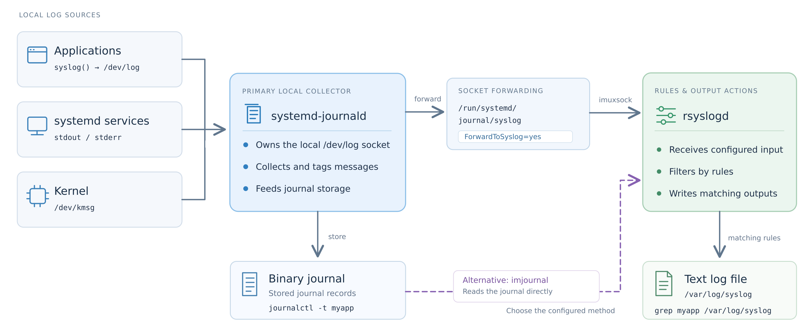

# Journald

`journald` is the logging component of systemd, designed to address the [limitations of syslog](09_syslog.md#limitations-of-syslog). It collects messages from the same sources — kernel, services, and applications — but stores them in a **structured binary format** with typed metadata fields instead of plain text.

Key improvements over syslog:

- **Structured storage** — each log entry is a set of key-value fields, enabling precise filtering
- **Unified journal** — kernel messages, service output, and application logs are all collected in one place
- **Boot awareness** — logs are tagged by boot ID, so you can isolate logs from any specific boot
- **Queryable** — the `journalctl` tool can filter by time, unit, priority, boot, and arbitrary fields
- **Integrity** — supports cryptographic sealing to detect tampering
- **Syslog-compatible** — can forward messages to a traditional syslog daemon, so both systems can coexist

## journald Configuration

`journald` is configured through `/etc/systemd/journald.conf` (or drop-in files in `/etc/systemd/journald.conf.d/`). All settings go under the `[Journal]` section. After changing the configuration, restart the service:

    $ sudo systemctl restart systemd-journald

### Storage Mode

The `Storage=` option controls where journal data is written:

| Value        | Behavior                                                                 |
|--------------|--------------------------------------------------------------------------|
| `persistent` | Store on disk under `/var/log/journal/` (survives reboots)               |
| `volatile`   | Store in memory under `/run/log/journal/` (lost on reboot)               |
| `auto`       | Use `persistent` if `/var/log/journal/` exists, otherwise `volatile`     |
| `none`       | Drop all log data (forwarding to syslog or the console still works)      |

The default is `persistent` on most distributions. If you need logs to survive reboots — which is almost always the case — ensure this is set to `persistent` or `auto` with the `/var/log/journal/` directory created.

### Rate Limiting

`journald` applies rate limiting **per service** to prevent a single runaway process from flooding the journal:

| Option                   | Description                                          | Default        |
|--------------------------|------------------------------------------------------|----------------|
| `RateLimitIntervalSec=`  | Time window for counting messages                    | 30s            |
| `RateLimitBurst=`        | Maximum messages allowed per service per interval    | 10000          |

If a service exceeds the burst limit within the interval, all further messages from that service are dropped until the interval resets. `journald` logs a single line indicating how many messages were suppressed.

To disable rate limiting entirely, set either value to `0`:

```ini
[Journal]
RateLimitIntervalSec=0
```

> **Note:** Individual services can override these defaults using `LogRateLimitIntervalSec=` and `LogRateLimitBurst=` in their unit file's `[Service]` section.

## journalctl

`journalctl` is the command-line tool for querying the journal. Because the journal stores structured binary records, `journalctl` can filter in ways that are not possible by searching plain text files.

### Viewing All Logs

To display the complete journal across all boots:

    $ journalctl

Each line shows the timestamp, hostname, unit name, PID, and the message:

```
-- Logs begin at Sun 2024-12-01 12:26:58 PST, end at Fri 2025-01-10 17:18:42 PST. --
Dec 01 12:26:58 myhost systemd[9898]: Started Pending report trigger for Ubuntu Report.
Dec 01 12:26:58 myhost systemd[9898]: Reached target Paths.
Dec 01 12:26:58 myhost systemd[9898]: Reached target Timers.
Dec 01 12:26:58 myhost systemd[9898]: Starting D-Bus User Message Bus Socket.
```

### Filtering by Boot

`journald` retains logs from previous boots by default (unless configured otherwise). To list all recorded boots with their timestamps:

    $ journalctl --list-boots

To view logs from the current boot only:

    $ journalctl -b

To view logs from a previous boot (use `-1` for the previous boot, `-2` for the one before that, and so on):

    $ journalctl -b -1

### Filtering by Unit

To view logs for a specific systemd unit:

    $ journalctl -u <unit>

For example, to see all log entries from the SSH service:

    $ sudo journalctl -u ssh

### Filtering by Priority

To show only messages at a specific severity level and above, use `-p`:

    $ journalctl -p err

This shows all messages at `err` severity and above (`err`, `crit`, `alert`, `emerg`). You can use either the name or the numeric code:

    $ journalctl -p 3

To show a **range** of priorities, use `..` as a separator:

    $ journalctl -p warning..err

This shows only `warning` and `err` messages, excluding `crit`, `alert`, and `emerg`.

### Filtering by Time

To show messages from a specific time range, use `--since` and `--until`:

    $ journalctl --since "2025-01-10 09:00:00" --until "2025-01-10 12:00:00"

Relative time expressions are also supported:

    $ journalctl --since "1 hour ago"
    $ journalctl --since "yesterday"

These filters combine naturally with other options:

    $ journalctl -u nginx -p err --since "2 hours ago"

### Output Formats

By default, `journalctl` displays a compact one-line-per-entry format. The `-o` flag selects alternative formats:

| Format        | Description                                                    |
|---------------|----------------------------------------------------------------|
| `short`       | Default — resembles traditional syslog output                  |
| `short-precise` | Like `short` but with microsecond timestamps                 |
| `verbose`     | Shows all metadata fields for each entry                       |
| `json`        | One JSON object per entry (useful for scripting)               |
| `json-pretty` | Like `json` but formatted for readability                      |
| `cat`         | Message text only, with no timestamps or metadata              |

Example — view full metadata for SSH service logs:

    $ sudo journalctl -u ssh -o verbose

Example — export recent errors as JSON for processing by another tool:

    $ journalctl -p err --since "1 hour ago" -o json

### Following New Entries

To watch new log entries in real time (similar to `tail -f`):

    $ journalctl -f

This is useful for monitoring a service while testing or troubleshooting. Combine with other filters to watch a specific unit:

    $ journalctl -f -u nginx

### Permissions

Journal logs are owned by the `systemd-journal` group:

    $ ls -ld /var/log/journal
    drwxr-sr-x+ 3 root systemd-journal 4096 Dec  1 12:25 /var/log/journal

Only users in this group (or root via `sudo`) can read all log entries. Without `sudo`, you may not have permission to view logs for certain services such as `ssh`.

## Journal Disk Management

Unlike syslog text files (which rely on [`logrotate`](09_syslog.md#log-rotation)), `journald` manages its own disk usage automatically. It enforces size limits through configuration directives and provides manual cleanup commands through `journalctl`.

### Size Limits

`journald` enforces disk usage limits to prevent the journal from consuming all available space:

| Option            | Description                                                      | Default            |
|-------------------|------------------------------------------------------------------|--------------------|
| `SystemMaxUse=`   | Maximum disk space the journal may occupy                        | 10% of filesystem  |
| `SystemKeepFree=` | Minimum free space to leave on the filesystem                    | 15% of filesystem  |
| `SystemMaxFileSize=` | Maximum size of individual journal files                      | 1/8 of `SystemMaxUse` |

`journald` respects **both** `SystemMaxUse` and `SystemKeepFree`, using whichever limit is more restrictive. Each default is also capped at 4 GB. For example, on a 100 GB filesystem, `SystemMaxUse` defaults to 4 GB (the cap) rather than 10 GB.

When the journal reaches its size limit, `journald` automatically deletes the oldest archived journal files to make room for new entries. This happens continuously — there is no external tool or scheduled job involved.

Example — limit the journal to 2 GB in `/etc/systemd/journald.conf`:

```ini
[Journal]
SystemMaxUse=2G
```

### Checking Disk Usage

To see how much disk space the journal is currently consuming:

    $ journalctl --disk-usage

### Manual Cleanup

To reclaim space immediately without waiting for the automatic limits:

    $ sudo journalctl --vacuum-size=1G
    $ sudo journalctl --vacuum-time=7d

The first command removes archived journal files until total usage drops below 1 GB. The second removes all entries older than 7 days. Both commands only delete archived (sealed) journal files — the currently active journal file is never removed.

## How journald and rsyslog Coexist

On most modern distributions, `journald` and `rsyslog` run side by side. Understanding how they interact avoids confusion about where logs end up. `journald` is the **primary collector**. On a systemd system, `journald` owns the `/dev/log` socket — `rsyslog` does not listen on it directly. `journald` receives messages from all sources:

- the kernel (`/dev/kmsg`)
- systemd services (stdout/stderr)
- the syslog socket (`/dev/log`)

Every message enters the journal first.



`rsyslog` then receives messages from `journald` through one of two mechanisms:

- **Socket forwarding (`imuxsock`)** — When `ForwardToSyslog=yes` is set in `journald.conf`, `journald` forwards each message to a separate socket at `/run/systemd/journal/syslog`. `rsyslog`'s `imuxsock` module reads from this socket. This is the default approach on Debian and Ubuntu (where the `rsyslog` package ships a drop-in that enables `ForwardToSyslog=yes`).

- **Direct journal reading (`imjournal`)** — `rsyslog`'s `imjournal` module reads the journal database files directly. This provides access to structured journal metadata (key-value fields) that are lost in socket forwarding, but it is slower. This is the default approach on Red Hat-based systems.

Both approaches should not be enabled simultaneously, as that would produce duplicate messages.

The result is that **both systems contain the same messages**, but in different formats:

| System     | Storage format    | Query tool    | Survives reboot?        |
|------------|-------------------|---------------|-------------------------|
| `journald` | Structured binary | `journalctl`  | If `Storage=persistent` |
| `rsyslog`  | Plain text files  | `grep`, `awk` | Yes (files on disk)     |

This dual-logging is intentional. `journalctl` is powerful for interactive debugging (filtering by unit, boot, priority, and time). Traditional text files are useful for tools that expect plain text, for shipping to remote log aggregators, and as a familiar fallback.

If disk space is a concern and you only want one system, you can disable `rsyslog`:

    $ sudo systemctl disable --now rsyslog

The journal will continue to collect all messages, and `journalctl` remains fully functional. The `/var/log/syslog` and related text files will no longer be written.

---

[← Previous: Syslog](09_syslog.md) | [Next: Targets and Boot Flow →](11_systemd_targets.md)
